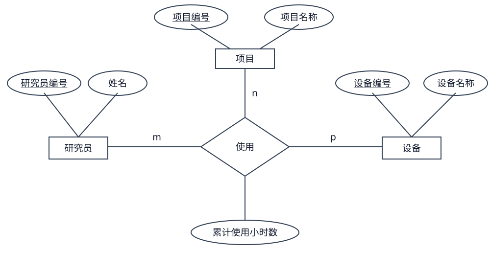

# 第七章 数据库设计习题

知识点总结见[总结：第七章数据库设计](总结.md#第七章-数据库设计)。

## 一、例题与解析

下面参考《数据库系统概论（第6版）习题解析与实验指导》第七章的题型，结合本章 PPT 自编例题。参考范围为书内第 71～74、77～78 页（PDF 第 86～89、92～93 页），主要包括设计阶段判断、实体与属性划分、E-R 建模及关系模式转换。物理设计题依据本章 PPT 第 96～117 页。题目和解析均为重新设计，不是书中原题或原答案。

### 例题 1：判断数据库设计阶段

某图书馆准备建立借阅系统。工作人员先调查借阅规则和查询需求，再画出读者、图书、借阅之间的 E-R 图，随后把 E-R 图转换成关系模式，并为普通读者设计只能查看本人借阅记录的视图，最后根据查询频率决定是否在借阅日期上建立索引。上述工作分别属于哪个设计阶段？需求分析阶段形成的数据字典中，记录的是每一笔借阅数据吗？
需求分析 概念结构设计（ER图）转换成关系 逻辑结构设计 设计用户视图 逻辑结构设计
建立索引 物理结构设计

**解析：**

| 工作 | 所属阶段 | 判断依据 |
| --- | --- | --- |
| 调查借阅规则和查询需求 | 需求分析 | 明确用户需要什么数据、完成什么操作 |
| 画出 E-R 图 | 概念结构设计 | 将用户需求抽象为概念模型 |
| 转换成关系模式 | 逻辑结构设计 | 把概念模型转换为 DBMS 支持的数据模型 |
| 设计用户视图 | 逻辑结构设计 | 属于设计用户子模式 |
| 决定是否建立索引 | 物理结构设计 | 选择存取方法 |

数据字典记录的是数据的描述，例如“借阅日期”的含义、类型、取值要求，而不是某位读者在某天借了哪本书的具体记录。

容易混淆的是：**设计用户视图属于逻辑设计，选择索引属于物理设计。**不能因为二者都可能用 SQL 实现，就把它们归为同一个设计阶段。

### 例题 2：什么时候把属性改成实体

某培训机构最初只记录学员编号、姓名和所学专业名，每位学员只能选择一个专业，也不单独管理专业的其他信息。后来业务变为：每个专业需要记录专业编号、专业名称和学制，每位学员可以选择多个专业，每次专业选择还要记录入学日期。请说明前后两种情况下，专业应如何建模，入学日期应该放在哪里。
学员 编号 姓名 
专业 专业编号 专业名称 学制
学员专业选择 学员编号 专业编号 入学日期
**解析：**

最初，专业没有其他需要单独描述的性质，也不需要参与其他联系，可以作为学员的一个属性：学员（学员编号，姓名，专业名）。

需求变化后，专业具有专业编号、名称和学制等自身属性，而且一个学员可以选择多个专业，所以应当单独建为实体，并建立学员与专业之间的多对多“选择”联系。

入学日期属于“选择”联系。原因是同一个学员进入不同专业的日期可以不同，同一个专业的不同学员入学日期也可以不同，必须同时确定学员和专业才能确定该日期。

假设本系统对每一对“学员、专业”只保存一次入学记录，可以转换为：

- 学员（学员编号，姓名），主码：学员编号。
- 专业（专业编号，专业名称，学制），主码：专业编号。
- 选择（学员编号，专业编号，入学日期），主码：（学员编号，专业编号）；两个编号分别是参照学员、专业的外码。

**判断联系属性时，可以问：只知道一个实体，能不能确定这个值？**如果要同时知道参与联系的双方才能确定，通常应考虑把它放在联系上。

### 例题 3：1∶1、1∶n、m∶n 如何转换

某公司管理部门、员工和项目。部门有部门编号、部门名称，员工有员工编号、姓名，项目有项目编号、项目名称。每个员工只属于一个部门，一个部门可以有多个员工；每个部门恰有一位经理，一名员工至多担任一个部门的经理，经理必须属于自己管理的部门；员工可以参加多个项目，一个项目可以有多个员工参加，每对员工和项目只记录一个工时比例。请分析联系类型，并将其转换为关系模式，标出主码、外码以及其他必要约束。

**解析：**

先分别分析联系，不要把“属于”“管理”“参加”混在一起。

| 联系 | 类型 | 联系属性 |
| --- | --- | --- |
| 部门与员工的“属于” | 1∶n | 无 |
| 部门与员工的“管理” | 1∶1 | 无 |
| 员工与项目的“参加” | m∶n | 工时比例 |

按照“1∶n 合并到 n 端、1∶1 可合并到任意一端、m∶n 单独建关系”的规则，一种转换结果是：

| 关系模式 | 主码 | 外码及其他约束 |
| --- | --- | --- |
| 部门（部门编号，部门名称，经理编号） | 部门编号 | 经理编号参照员工编号，非空且唯一 |
| 员工（员工编号，姓名，部门编号） | 员工编号 | 部门编号参照部门，非空 |
| 项目（项目编号，项目名称） | 项目编号 | 无 |
| 参加（员工编号，项目编号，工时比例） | （员工编号，项目编号） | 员工编号、项目编号分别参照员工、项目；工时比例大于 0 且不超过 1 |

“属于”合并到员工表，在员工中加入部门编号；“管理”合并到部门表，在部门中加入经理编号；“参加”单独建表，并放入双方的码和联系属性。

经理编号非空，表示每个部门必须有经理；经理编号唯一，表示一名员工至多管理一个部门。

**还要补充语义约束：经理必须属于所管理的部门。**只把经理编号设成参照员工的外码，只能保证这名员工存在，不能保证他的部门正确。这条约束需要另外表达；本题不要求编写实现它的 SQL。

题目没有要求一个员工所有项目的工时比例之和必须等于 1，因此不额外添加这条业务规则。

### 例题 4：三元联系为什么不能随意拆成三个二元联系

某实验室记录供应商向项目供应材料的情况。供应商有供应商编号和名称，项目有项目编号和名称，材料有材料编号和名称。同一个供应商可以向多个项目供应多种材料，同一种材料也可以由不同供应商供应给不同项目。系统只保存每组“供应商、项目、材料”的累计供应量，不保存每次送货记录。请给出关系模式，并说明能否只保存“供应商—项目”“供应商—材料”“项目—材料”三个二元关系。

**解析：**

这是供应商、项目、材料之间的三元“供应”联系。累计供应量必须同时确定这三个实体后才能确定，所以属于这个三元联系。

除供应商、项目、材料三个实体关系外，还应建立：

供应（供应商编号，项目编号，材料编号，累计供应量）。

主码是（供应商编号，项目编号，材料编号），三个编号分别参照对应实体。题目没有额外限制某两个编号就能决定第三个编号，因此这里使用三个编号的组合。

只保存三个二元关系会丢失“谁给哪个项目供应哪种材料”的准确对应。假设实际供应记录只有：

| 供应商 | 项目 | 材料 |
| --- | --- | --- |
| S1 | J1 | M1 |
| S1 | J2 | M2 |
| S2 | J1 | M2 |

拆开后能分别找到 S1 与 J1、S1 与 M2、J1 与 M2 的配对，但原记录中**不存在（S1，J1，M2）**。把三个二元关系重新连接起来，会拼出这条不存在的供应记录。

因此，“三个实体两两之间都有关系”并不等于“三个实体之间的具体对应关系已经保存完整”。

### 例题 5：索引选择与水平、垂直分解

某订单系统有订单（订单编号，客户编号，下单日期，状态，备注），经常按下单日期查询一个月内的订单，也经常按订单编号查一笔订单。约 90% 的访问只涉及最近一年的记录，而且很少读取篇幅较长的备注。请说明应优先考虑哪些索引，把近一年订单与历史订单分开属于什么分解，把备注单独存放又属于什么分解，为什么不能给每一列都建立索引。

**解析：**

日期范围查询可以考虑在下单日期上建立 B+ 树索引。按订单编号进行等值查询，可以考虑 B+ 树索引；如果满足课件给出的 Hash 使用条件，也可以考虑 Hash。**等值查询不是只能使用 Hash。**如果订单编号作为主码已经有可用索引，应先检查现有索引，避免重复建立。

把近一年订单与历史订单分开，分的是行，属于水平分解。实际是否采用，还要看跨时间段查询、数据迁移和维护成本，不能只看单个查询会不会变快。

把备注单独存放，分的是列，属于垂直分解。例如：

- 订单基本信息（订单编号，客户编号，下单日期，状态）。
- 订单备注（订单编号，备注）。

两张表都保留订单编号，才能按编号把一笔订单的基本信息和备注对应起来。这样可能减少常用查询读取的数据量，但需要备注的查询可能增加一次连接。

不能给每一列都建立索引，因为索引需要存储空间，插入、删除、修改时还需要维护。最终应综合比较**存取时间、存储空间利用率和维护代价**。

## 二、独立练习

下面的题目为自编练习。建议按顺序作答：第 1～2 题检查概念，第 3～5 题练习建模和转换，第 6 题练习物理设计。画图题采用课件中的 Chen 式 E-R 图：实体用矩形、属性用椭圆、联系用菱形，标出联系类型。暂时不要求写建表 SQL，也不涉及第六章范式推导。

### 练习 1：设计阶段与数据字典

某医院建设预约系统，依次开展以下工作：调查每天的预约量和允许取消预约的时间，描述预约编号及预约时间的含义和取值要求，画出患者、医生、预约之间的 E-R 图，将概念模型转换成关系模式，为患者建立只显示本人预约的视图，决定在预约日期上建立索引，导入旧系统数据并开展试运行。请分别说明这些工作所属的数据库设计阶段，指出哪些阶段与具体 DBMS 密切相关，并解释数据字典中的“预约时间描述”与一条具体预约记录中的“预约时间值”有什么区别。

### 练习 2：属性还是实体

某运动中心最初只记录会员编号（member_id）、姓名（name）和所报项目名称（sport_name），每位会员只能报一个项目。后来每个项目需要记录项目编号（sport_id）、名称和收费标准（fee），会员可以同时报名多个项目，每次报名需要记录报名日期（enroll_date）和实际缴费金额（paid_amount）；同一个会员对同一个项目只保留一条当前报名记录。请说明项目在前后两种需求中分别如何建模，报名日期和实际缴费金额应属于哪个实体或联系，并画出变化后的 E-R 图，转换成关系模式，标明主码和外码。

### 练习 3：社团管理系统

学校管理学生、社团和活动。学生有学号（student_id）和姓名（name），社团有社团编号（club_id）和名称（club_name），活动有活动编号（event_id）、名称（event_name）和举行日期（event_date）。学生可以加入多个社团，每个社团可以有多个学生，每对学生与社团只保存一次入社日期（join_date）；每个社团恰有一名社长，一名学生至多担任一个社团的社长，且社长必须是该社团成员。每项活动只由一个社团举办，一个社团可以举办多项活动。请画出 E-R 图并转换成关系模式，标明主码、外码、必要的非空与唯一约束，以及不能仅靠普通单列外码表达的业务要求。

### 练习 4：设备在项目中的使用

某研究中心有研究员、项目和设备，分别由研究员编号（researcher_id）、项目编号（project_id）和设备编号（device_id）唯一标识，并分别记录姓名或名称。一名研究员可以参与多个项目，也可以在不同项目中使用不同设备；同一项目的同一设备可以由多名研究员使用。系统记录每组“研究员、项目、设备”的累计使用小时数（hours），不记录单次使用过程，也不规定任意两个编号可以决定第三个编号。请画出 E-R 图并转换成关系模式，标明码；再自行举出三条实际记录，说明只保存三个两两配对的关系可能产生什么问题

研究员 编号 名字
项目 编号 名称
设备 编号 名称
使用记录 用时 研究员编号 项目编号 设备编号

#### 参考答案与解析

你的四个关系划分是对的，需要进一步标明联系类型、主码和外码。

**1. 如何确定联系**

把题目读成一句完整的话：“某个研究员，在某个项目中，使用某台设备，累计使用了多少小时。”这件事同时涉及研究员、项目、设备，所以应建立一个三元“使用”联系。

判断三元联系的类型，要固定其中两个实体，看第三个能否有多个：

| 固定的两个实体 | 第三个实体 |
| --- | --- |
| 项目 P1、设备 D1 | 可以由多个研究员使用 |
| 研究员 R1、项目 P1 | 可以使用多台设备 |
| 研究员 R1、设备 D1 | 可以用于多个项目 |

题目没有规定任意两个编号能决定第三个编号，因此三端都允许多个，是 m∶n∶p 的三元联系。

**2. E-R 图与联系属性**

三个实体用矩形，“使用”联系用菱形，属性用椭圆，下划线表示实体的码。图中的 m、n、p 表示三端均可为多，不代表固定数量。

累计使用小时数属于“使用”联系。只知道研究员与项目，不知道设备，不能确定用时；只知道研究员与设备，不知道项目，也不能确定用时。必须同时确定研究员、项目、设备，才能确定这一组的累计用时。

**3. 转换为关系模式**

| 关系模式 | 主码 | 外码 |
| --- | --- | --- |
| 研究员（researcher_id，name） | researcher_id | 无 |
| 项目（project_id，name） | project_id | 无 |
| 设备（device_id，name） | device_id | 无 |
| 使用记录（researcher_id，project_id，device_id，hours） | （researcher_id，project_id，device_id） | 三个编号分别参照研究员、项目、设备的主码 |

使用记录中，三个编号共同作为主码，因为系统只为每组三个编号保存一个累计用时，而任意两个编号都不能唯一确定一条记录。hours 是联系属性，不属于主码。

**4. 为什么不能只保存三个两两配对的关系**

假设实际只有以下三条使用记录：

| 研究员 | 项目 | 设备 | 累计用时 |
| --- | --- | --- | --- |
| R1 | P1 | D1 | 5 |
| R1 | P2 | D2 | 8 |
| R2 | P1 | D2 | 3 |

拆成三个二元关系后，可以分别找到：

- 研究员—项目中的（R1，P1），来自第一条记录。
- 研究员—设备中的（R1，D2），来自第二条记录。
- 项目—设备中的（P1，D2），来自第三条记录。

重新连接三个二元关系，就可能拼出（R1，P1，D2），但实际并不存在这条使用记录。三个两两配对的关系丢失了“谁在哪个项目中使用哪台设备”的准确对应，也不能据此确定该组合的累计用时。因此应保留三元“使用”联系。

### 练习 5：加入历史记录后怎样修改设计

某志愿服务平台原来记录志愿者（volunteer_id，name）、团队（team_id，team_name）及加入（volunteer_id，team_id，join_date），加入关系以（volunteer_id，team_id）为主码，只保存当前成员关系。现在要求记录成员历史：一位志愿者可以退出某团队后再次加入，每次加入都分配一个全平台唯一的记录编号（membership_id），并记录加入时间（joined_at）和退出时间（left_at）；尚未退出时退出时间为空。同一位志愿者在同一团队中最多只能有一条尚未退出的记录。请说明原来的主码为什么不再适合保存历史，给出修改后的关系模式和主码、外码，并说明还需保留哪条有关当前成员记录的约束。

### 练习 6：为查询选择物理设计

某设备监测系统保存记录（record_id，device_id，collected_at，status，raw_payload），每天持续插入大量数据。常用查询是按设备编号和时间范围检索记录，历史查询很少，raw_payload 是体积较大的原始报文，只有排查问题时才读取。现有三个建议：给所有属性都建索引；把最近一个月与更早的数据分开；把原始报文与常用属性分开存放。请逐一评价这些建议，说明后两种属于哪类分解、分解后如何恢复对应关系，并给出你会优先评估的索引方案。最后说明为什么不能仅凭“查询可能更快”就确定采用某种方案。

#### 参考答案与解析

这道题的关键是根据系统的实际使用方式选择物理设计。题目给出的三个特点是：按设备和时间范围查询、很少查询历史数据、很少读取较大的原始报文；同时，系统每天需要插入大量记录。

**1. 不建议给所有属性都建立索引**

索引应围绕经常使用的查询条件建立。题目没有说明经常按 status 或 raw_payload 查询，因此没有充分理由给它们都建立索引。

索引要占用存储空间，每插入一条记录，还需要维护相关索引。系统每天持续插入大量数据，索引过多可能明显增加写入开销。因此，不能只考虑查找速度，还要考虑存储空间和维护代价。

**2. 最近一个月与更早的数据分开：水平分解**

水平分解是按行拆分。两部分的属性相同，只是保存的记录不同：

| 分解后的关系 | 保存内容 | 属性 |
| --- | --- | --- |
| 最近记录 | collected_at 大于等于划分边界的记录 | record_id、device_id、collected_at、status、raw_payload |
| 历史记录 | collected_at 小于划分边界的记录 | record_id、device_id、collected_at、status、raw_payload |

常用查询如果只涉及最近一个月，便可能只访问最近记录，减少需要处理的数据。实际是否获益，还要结合索引和查询执行情况判断。

恢复完整记录集合时，将两部分按行合并。若两部分互不重叠且覆盖全部记录，可使用 UNION ALL，不需要按 record_id 连接两张表。

需要注意：分界条件必须明确，边界日期不能重复或遗漏；随着时间推移，要维护哪些记录属于历史数据。跨越分界的查询需要访问两部分，record_id 的全局唯一性也需要保证。

**3. 原始报文与常用属性分开：垂直分解**

垂直分解是按列拆分，可以设计为：

| 分解后的关系 | 属性 | 主码与联系 |
| --- | --- | --- |
| 监测基本记录 | record_id、device_id、collected_at、status | record_id 为主码 |
| 原始报文 | record_id、raw_payload | record_id 为主码，同时是参照监测基本记录的外码 |

两张表都保留 record_id，用它将同一条记录的两部分对应起来。需要读取完整记录时，按两张表的 record_id 相等进行连接。

如果每条监测记录都必须有对应报文，还需要保证两部分一一对应，写入和删除时保持一致；仅有“原始报文参照基本记录”的外码，不能保证每条基本记录一定有报文。

常用查询不读取 raw_payload 时，垂直分解可能减少需要读取的数据量；排查问题时则可能增加一次连接。具体收益还与数据库是否已经将大字段单独存储等实现有关，需要实际评估。

**4. 优先评估（device_id，collected_at）上的 B+ 树组合索引**

常用查询可以理解为：“找设备 D1 在某个时间段内的记录”。其中 device_id 是等值条件，collected_at 是范围条件。

可以优先评估按以下顺序建立的组合索引：

（device_id，collected_at）

可以把它理解为先按设备编号排列，同一设备内部再按采集时间排列。查询时先定位设备 D1 的记录，再定位其中指定的时间范围。

| 索引选择 | 判断依据 |
| --- | --- |
| B+ 树组合索引（device_id，collected_at） | 同时利用设备等值条件与时间范围条件，是本题优先评估的方案 |
| 只有 device_id 的索引 | 可以定位设备，但还需要筛选该设备的时间范围 |
| 只有 collected_at 的索引 | 可以定位时间范围，但还需要筛选设备 |
| Hash 索引 | 适合等值查找，不能直接支持这里的时间范围定位 |

这里的“优先评估”不表示一定最快。还要考虑每台设备有多少记录、查询时间范围有多大、数据库的具体实现以及持续插入时的维护成本。如果 record_id 是主码且已有索引，应先利用已有索引，避免重复建立。

**5. 为什么不能只凭“查询可能更快”就确定方案**

物理设计应综合比较存取时间、存储空间利用率和维护代价。对于本题，还需要观察查询响应时间、插入吞吐量、索引占用空间、历史数据迁移成本，以及读取原始报文时的连接开销。

本题可概括为：有针对性地建立索引；近期与历史数据按行分开，是水平分解；原始报文与常用属性按列分开，是垂直分解；最终依据实际访问方式和读写成本选择方案。
